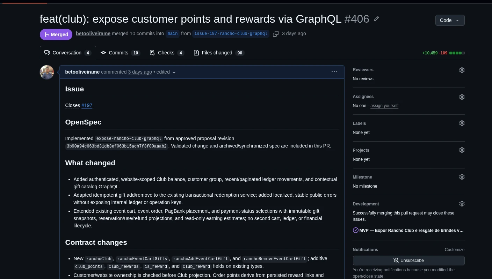
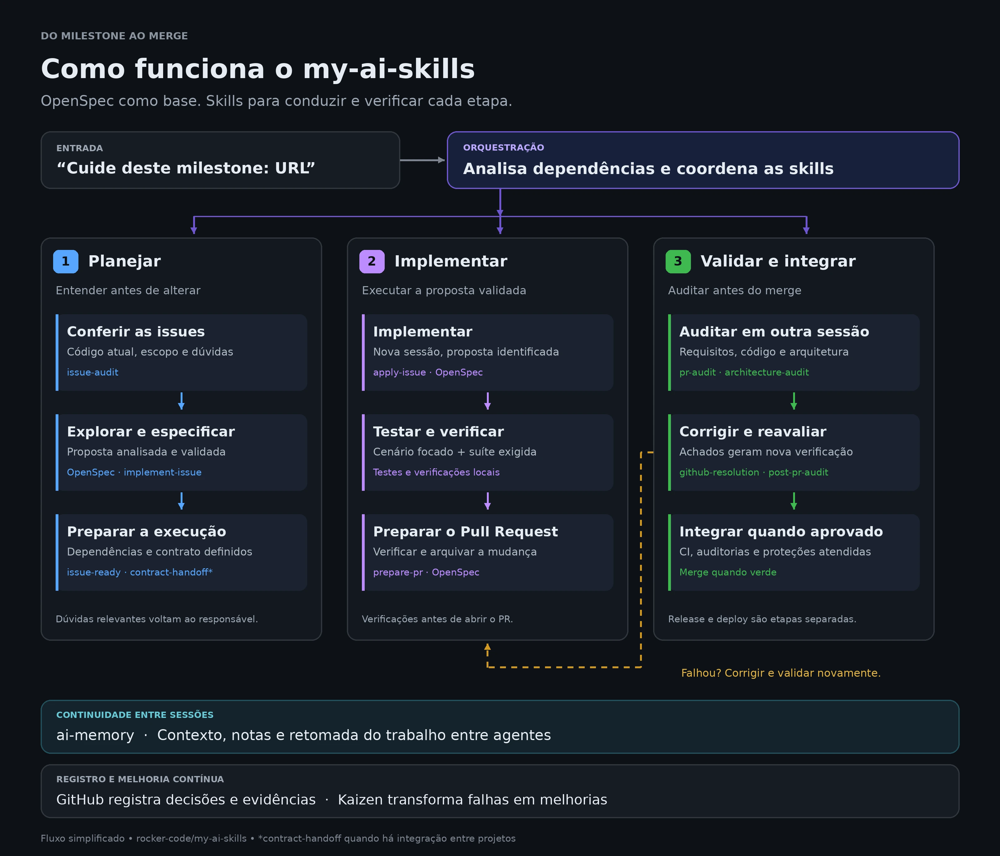
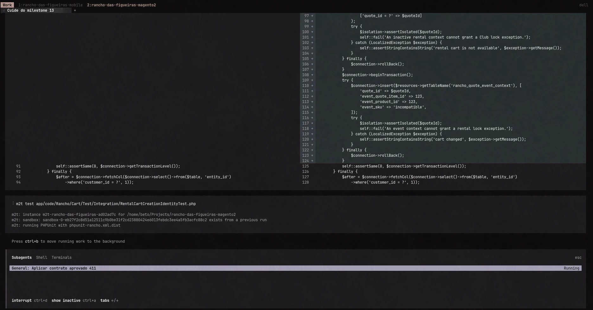
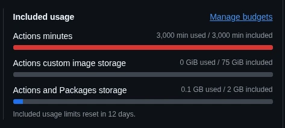

{: .img-fluid}

No meu último post, [“Código virou commodity. E agora?”](https://betooliveira.com/profissionalismo/engenharia-de-software/2026/09/12/codigo-virou-commodity-e-agora.html), falei sobre o desafio de revisar tudo aquilo que os agentes de IA conseguem produzir. Desde então, tenho levado essa discussão para um experimento bastante prático nos meus projetos: já não reviso manualmente todos os Pull Requests. Tenho tentado fazer com que a IA participe do processo inteiro, da análise da issue à implementação, passando pelos testes, pelas revisões e pelas correções até o merge.

Sim, isso inclui deixar que agentes revisem o código produzido por outros agentes ou por outras sessões. O próprio Robert C. Martin, o Uncle Bob, [relatou que sua estratégia passou a ser não ler o código escrito por seus agentes](https://x.com/unclebobmartin/status/2080257779395154409). Achei curioso ver essa discussão vindo de alguém tão associado à qualidade de código. No meu caso, continuo acompanhando decisões e problemas do projeto, mas a leitura manual de cada alteração deixou de ser uma etapa pela qual todos os PRs obrigatoriamente passam.

A motivação é bem pé no chão. Tenho meu trabalho CLT e uma quantidade limitada de horas para dedicar aos projetos paralelos. Quero que, enquanto estou ocupado com meu trabalho do dia a dia, os agentes continuem avançando no meu computador sem precisar me chamar a cada passo. É esse modelo que venho tentando construir no desenvolvimento de um aplicativo mobile com Expo e backend Magento Open Source.

Conforme consegui automatizar mais etapas, descobri que havia bastante coisa além do Code Review para resolver. Testes, ambiente local, consumo de IA, minutos de pipeline, builds do aplicativo e controle da arquitetura começaram a ocupar uma parte maior das minhas preocupações. Eu estava conseguindo produzir mais código, mas todo o restante do processo também precisava acompanhar esse ritmo. E uma parte dele tinha franquia mensal.

## O ponto de partida foi o OpenSpec

Não comecei esse processo montando um sistema inteiro de automação. Meu ponto de partida foi o OpenSpec, que passei a usar como base para explorar os problemas, especificar as mudanças e orientar a implementação. Queria ter uma estrutura para entender o que seria desenvolvido e registrar as decisões antes de deixar o agente alterar o projeto. Conforme fui usando essa base no dia a dia, começaram a aparecer necessidades ao redor dela.

Como organizar o trabalho de um milestone? Como conferir se uma issue ainda fazia sentido diante do código atual? Como lidar com dúvidas que aparecem durante a exploração? Quem analisa a proposta? Como conduzir as correções depois de uma revisão? Fui criando e acrescentando skills, scripts e outros complementos para tratar essas questões. Assim nasceu o [my-ai-skills](https://github.com/rocker-code/my-ai-skills), mantendo o OpenSpec como base e ampliando o processo ao redor dele.

Uma parte importante dessa evolução tem sido transformar dificuldades reais em orientações reutilizáveis. Quando o agente repete um erro ou fica perdido em determinada etapa, tento entender se faltou contexto, se a instrução estava ambígua ou se existe um problema no ambiente. Dependendo da resposta, ajusto a issue, a especificação, a skill ou a infraestrutura. Não quero precisar explicar a mesma coisa toda vez que uma nova sessão começa.

Também comecei a me incomodar com a quantidade de interrupções. Se eu preciso voltar ao terminal para aprovar cada proposta e autorizar cada próximo passo, a autonomia fica bastante limitada. Tenho buscado colocar mais critérios de análise nas próprias skills para que o fluxo avance quando existem informações suficientes. Quando falta uma decisão de negócio ou aparece uma ambiguidade relevante, aí sim faz sentido me chamar. Essa diferença tem sido importante para conseguir conciliar o desenvolvimento com o restante do meu dia.

## No caminho, encontrei o trabalho do Akita

Enquanto evoluía essas ferramentas, encontrei o [Akita’s AI Lair](https://ailair.akitaonrails.com/pt-br/), do Fabio Akita. Foi aquele momento de olhar e pensar: “Era exatamente isso que eu estava buscando, e o cara já está bem mais adiantado.” Havia várias ideias sobre workflow, skills e continuidade do trabalho que conversavam diretamente com os problemas que eu estava tentando resolver.

Então ~~roubei~~ peguei emprestadas algumas ideias dele e de outros projetos que apareceram pela minha bolha da internet, adaptando o que fazia sentido para as minhas ferramentas. Uma peça que me chamou bastante atenção foi o [ai-memory](https://aimemory.sh/), que mantém notas e contexto do projeto fora da sessão de um agente específico e ajuda a recuperar informações de trabalhos anteriores.

Quem usa essas ferramentas por períodos mais longos conhece o problema: uma sessão termina, outra começa e precisamos reconstruir parte do contexto. O que já foi tentado? Por que aquela alternativa foi descartada? Qual era a próxima pendência? Isso fica ainda mais interessante quando alternamos entre ferramentas. Se a continuidade depende exclusivamente do histórico de uma conversa, a troca pode virar uma nova rodada de explicações.

Essa preocupação com memória complementou o que eu já vinha tentando organizar no GitHub. Issues, decisões e Pull Requests precisam continuar sendo referências do trabalho. A memória ajuda a retomar o raciocínio e encontrar essas referências. Para o tipo de autonomia que estou buscando, conseguir continuar de onde paramos é quase tão importante quanto conseguir implementar a próxima funcionalidade.

## O que acontece quando peço para cuidar de um milestone

Hoje, uma das entradas do meu fluxo pode ser uma instrução como “Cuide deste milestone”, acompanhada da URL. Parece uma frase simples, mas há uma sequência de responsabilidades por trás dela. O processo começa conferindo as issues contra o código atual, identificando dependências e verificando se existem dúvidas que impedem o desenvolvimento. Isso evita partir diretamente de uma descrição que pode estar incompleta ou desatualizada.

Depois entram a exploração da solução, a preparação da proposta com OpenSpec e sua análise. A implementação deve começar em uma nova sessão, a partir da versão validada da proposta. Essa separação faz parte da tentativa de deixar claro o que foi decidido e o que precisa ser executado. Não quero que a especificação vá mudando silenciosamente para acompanhar qualquer solução que o agente resolveu implementar.

Após o desenvolvimento, entram testes, verificações locais, preparação do Pull Request e auditorias em sessões independentes. Quando aparecem problemas, o fluxo prevê correções e uma nova avaliação. O modo padrão permite merge quando os critérios exigidos, a CI e as proteções da branch são atendidos. Release e deploy continuam sendo operações separadas.

A captura abaixo mostra um exemplo desse registro: o Pull Request referencia a issue, identifica a revisão da proposta OpenSpec utilizada e descreve as mudanças entregues. Isso ajuda a retomar o que foi feito e a relacionar a implementação com a decisão que orientou o trabalho.

{: .img-fluid}

*Um exemplo de entrega registrada: issue, proposta OpenSpec e alterações reunidas no mesmo PR.*

Esse é o comportamento definido pelas ferramentas, e sigo ajustando sua execução na prática. Meu objetivo é conseguir me afastar por algumas horas e voltar encontrando trabalho avançado, evidências do que foi verificado e dúvidas concretas. Ainda existem bloqueios, ajustes no ambiente e situações em que preciso intervir. A diferença é que venho tentando fazer essas intervenções melhorarem também o próximo ciclo.

Um exemplo apareceu no alinhamento entre backend e aplicativo. Ter uma issue em cada repositório não garante que o contrato entregue por um lado cubra todos os cenários esperados pelo outro. Na funcionalidade de escolha de brindes, esse alinhamento exigiu atenção. Isso levou a uma preocupação mais explícita no fluxo com a passagem de contratos entre os projetos: conferir o que foi implementado, o que a tela precisa e quais lacunas precisam ser resolvidas antes de seguir.

Esse tipo de problema também tem custo. Se a descoberta acontece tarde, precisamos voltar ao backend, ajustar a entrega, rodar testes e revisar novamente. Às vezes, a próxima otimização está em uma pergunta que deveria ter sido feita antes.

O diagrama abaixo resume como essas peças se conectam. O OpenSpec continua sendo a base, enquanto as skills conduzem o planejamento, a implementação e a validação. O retorno para correções faz parte do fluxo, assim como a continuidade entre sessões e o registro das decisões.

{: .img-fluid}

*Do milestone ao merge: uma visão simplificada do processo que venho evoluindo.*

## Os testes começaram a ocupar boa parte do caminho

Um dos desafios que mais têm me incomodado está nos testes integrados. Em alguns momentos, vejo o agente gastar bastante tempo entre executar, encontrar uma falha, ajustar e tentar novamente. Esse ciclo é esperado no desenvolvimento, mas pode ficar caro quando o diagnóstico demora e cada tentativa exige preparar uma estrutura pesada.

No Magento, validar uma mudança pode envolver banco de dados, fixtures, configurações e dependências do ambiente. Quando um teste falha, precisamos descobrir se a implementação está errada, se os dados de teste estão inadequados ou se o problema está na preparação do ambiente. São situações diferentes. Alterar o código antes de entender a falha pode aumentar o retrabalho e ainda mexer em algo que estava correto.

Tenho tentado melhorar isso pelas próprias skills. A ideia é orientar o agente a conferir o ambiente e as fixtures antes de uma execução cara, começar por um cenário específico e investigar cada falha com uma hipótese clara. Depois dos ajustes, continua sendo necessário executar a validação completa exigida pelo projeto. O ganho que procuro está em chegar a essa execução com os problemas mais básicos já resolvidos.

Na imagem abaixo, o agente está trabalhando no projeto Magento e executando um teste integrado específico. É um recorte do tipo de atividade que tento deixar avançando sem depender da minha atenção contínua: implementar, verificar e reunir o resultado para o próximo passo.

{: .img-fluid}

*O agente em execução: alterações no código, teste integrado e uma sessão de trabalho em andamento.*

Ainda estou trabalhando nessa melhoria. O que já percebi é que gerar testes rapidamente não significa conseguir validá-los rapidamente. E, quando a mesma ferramenta escreve implementação e testes, também preciso ter critérios de aceite claros para que os dois não reproduzam o mesmo entendimento equivocado. Uma suíte verde só é útil se estiver verificando comportamentos relevantes para a entrega.

## A barra de minutos do GitHub entrou na conversa

Enquanto eu desenvolvia tudo manualmente, minha disponibilidade limitava naturalmente a quantidade de alterações que chegavam à pipeline. Com agentes avançando no trabalho, esse ritmo aumentou. Cada implementação pode gerar um PR, cada correção pode disparar outra execução e cada rodada de revisão pode exigir novos ajustes. A capacidade adicional de desenvolvimento também coloca mais trabalho na infraestrutura.

No GitHub Free, a franquia de Actions para repositórios privados é de 2.000 minutos mensais. Outros planos oferecem franquias maiores; runners padrão em repositórios públicos têm condições diferentes. No meu caso, a imagem abaixo mostra uma franquia de 3.000 minutos completamente consumida, com 12 dias pela frente até a renovação.

{: .img-fluid}

*Franquia consumida. Ainda faltavam 12 dias para renovar.*

Para quem desenvolve sozinho e precisa controlar o orçamento dos projetos, isso começa a pesar. Instalação de dependências, configuração de PHP, preparação do banco, análise estática e testes continuam precisando acontecer. Quando a pipeline é executada várias vezes ao longo do desenvolvimento, esses custos se acumulam. Não precisa existir uma execução absurdamente demorada para a soma do mês incomodar.

Uma das estratégias que comecei a adotar foi distribuir os jobs entre os runners do próprio GitHub e os da [Blacksmith](https://www.blacksmith.sh/), que anuncia 3.000 minutos gratuitos por mês. Os workflows continuam no GitHub Actions, mas parte das execuções passa a usar a infraestrutura da Blacksmith. Isso me dá uma margem adicional para acomodar o volume de validações.

Ao mesmo tempo, comecei a olhar com mais atenção para o trabalho repetido. Se análise estática e testes unitários executam em jobs separados, cada job pode configurar PHP e instalar as mesmas dependências novamente. Essa separação pode ajudar no paralelismo e no isolamento, mas preciso avaliar se compensa no meu cenário. Uma pipeline que termina mais rápido no relógio pode consumir mais minutos somados.

Ainda estou ajustando essa distribuição e buscando reduzir o desperdício. Não tenho uma porcentagem de economia para apresentar. Aproveitar outra franquia ajuda, mas também quero evitar gastar mais capacidade apenas para sustentar execuções que poderiam ser melhor organizadas. Esse esforço de otimização passou a fazer parte do desenvolvimento do projeto.

## No mobile e na própria IA, aparecem outros limites

O aplicativo também traz suas próprias contas. O plano gratuito do EAS Build, do Expo, oferece até 15 builds Android e 15 iOS por mês. No meu fluxo, os development builds ajudam bastante: depois de instalar um build de desenvolvimento, consigo trabalhar em muitas mudanças de JavaScript e TypeScript usando o servidor local, sem precisar gerar um novo binário a cada alteração. Mudanças em dependências ou configurações nativas podem exigir outro build.

Por isso, essa franquia tem sido mais administrável. Mesmo assim, preciso considerar quando um novo build é necessário e como vou distribuir as versões para testar. Automatizar o desenvolvimento não faz desaparecer as etapas de instalar o aplicativo, conferir os fluxos e avaliar o que está sendo entregue. Há uma diferença importante entre uma alteração passar na pipeline e a experiência funcionar bem no celular.

E, claro, existe o custo das ferramentas de IA. Eu vinha pagando algo na faixa de US$ 20 pelo plano que usava com Codex e outros US$ 20 pelo Claude, aproximadamente US$ 40 por mês nessa parte. Mesmo assim, em alguns momentos, atingia os limites de uso. É o que costumamos chamar de “ficar sem tokens”, embora, nesse caso, eu esteja falando das cotas dos planos, e não necessariamente de uma cobrança direta por token via API.

O consumo muda quando tentamos manter os agentes trabalhando por horas. Além de implementar, eles leem o repositório, exploram alternativas, escrevem testes, investigam falhas, revisam e corrigem. Uma funcionalidade pode passar por várias dessas etapas antes de estar pronta. Ter capacidade disponível para gerar a primeira versão não garante que a cota vá acompanhar todo o ciclo.

Para testar uma capacidade maior, assinei um plano Pro para usar com Codex. Quero entender se isso reduz as interrupções no meu ritmo de desenvolvimento e se o custo adicional faz sentido. Ainda estou avaliando. Se eu conseguir manter o agente ativo por mais tempo, mas ele continuar preso nas mesmas tentativas de corrigir o ambiente ou os testes, parte do investimento vai acabar sustentando o mesmo problema por mais horas.

Essa é uma preocupação que tem aparecido bastante: preciso olhar para onde a capacidade está sendo gasta. Mais minutos de runner e mais uso de IA ajudam, mas quero que isso resulte em funcionalidades concluídas e menos retrabalho.

## A arquitetura é uma das próximas experiências

Além de fazer a pipeline passar e manter os custos administráveis, quero entender melhor como acompanhar a arquitetura conforme o volume de mudanças cresce. O my-ai-skills já prevê auditorias arquiteturais, mas estou começando a avaliar ferramentas que permitam comparar alterações com um modelo explícito do sistema. Para quem deixa de ler todos os PRs manualmente, essa visibilidade ganha ainda mais importância.

Uma das ferramentas que quero testar é o [Erode](https://erode.dev/). Sua proposta é analisar mudanças de código em relação ao modelo arquitetural, procurando dependências não declaradas e desvios estruturais. A ideia é explorar isso com o [LikeC4](https://likec4.dev/), que permite descrever a arquitetura como código e gerar visualizações a partir dessa descrição.

Penso, por exemplo, em uma alteração que introduza uma comunicação entre componentes que não estava prevista. Quero que isso apareça durante a validação para que possamos avaliar se a dependência é adequada, se o código precisa mudar ou se o modelo deve ser atualizado. É um tipo de guardrail que quero experimentar para complementar as verificações existentes.

Essa parte ainda está em avaliação. Preciso entender o que a ferramenta detecta, a qualidade dos apontamentos, o esforço para manter o modelo e o custo de incluir mais uma análise no fluxo. Pretendo trazer essa experiência nos próximos posts, quando tiver resultados para discutir.

## O que mudou no meu trabalho

Sem IA, esse aplicativo levaria muito mais tempo para chegar onde está. Tenho uma disponibilidade limitada e consigo avançar em uma quantidade de trabalho que seria difícil executar sozinho no mesmo período. O ganho é perceptível para mim, e é justamente por isso que continuo investindo nesse processo.

Ao mesmo tempo, uma parte crescente do meu esforço está indo para a organização do desenvolvimento. Tenho trabalhado em especificações, instruções, memória, contratos entre projetos, testes, pipelines e critérios de revisão. Há dias em que melhorar a forma como os agentes executam o trabalho parece mais útil do que pedir mais uma funcionalidade.

Validar software sempre custou tempo e dinheiro. O que mudou no meu dia a dia foi o volume de implementações chegando a essa etapa. Quando consigo produzir mais, os limites que antes pareciam distantes começam a aparecer no orçamento, na infraestrutura e na minha capacidade de acompanhar o projeto.

Ainda estou ajustando tudo isso. Quero continuar aumentando a autonomia dos agentes, reduzir as interrupções e entender melhor o custo de cada entrega. Também quero compartilhar o que funcionar e o que der errado, porque tem bastante aprendizado acontecendo entre uma issue e um merge.

Eu esperava escrever menos código. Só não imaginava que passaria tanto tempo olhando para uma barra de minutos do GitHub Actions.

